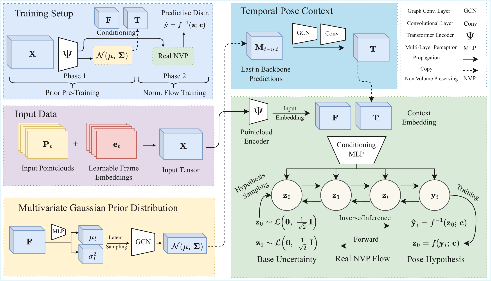

# You Only Flow Once: Calibrated and Real-Time Radar Pose Estimation with Multi-Hypothesis Normalizing Flows

Code and pretrained checkpoints of the WACV 2027 paper by Jonas Leo Mueller, Sebastian
Hoefler, Dario Zanca, Naga Venkata Sai Jitin Jami, Thomas Altstidl and Bjoern M. Eskofier.
The repository reproduces the MH-NFPG results of the paper on MM-Fi, mmRadPose and mRI
from the released MG-Prior weights, and provides the training code of both phases, the
MG-Prior + DiffPose and mmDiff baselines and the runtime benchmark.

<p align="center">
  
</p>

MH-NFPG estimates 3D human poses from radar point clouds together with calibrated
uncertainty, in one forward pass. Phase 1 trains the **MG-Prior**: a spatiotemporal
transformer over five aggregated radar frames with a Gaussian prediction head whose
pose samples are refined by a graph convolution along the skeleton. Phase 2 trains
**NFPG**, a conditional RealNVP normalizing flow with a Laplace base distribution, on
the backbone features and the recent MG-Prior predictions. At test time 200 pose
hypotheses are drawn in parallel; their mean is the point estimate and their spread the
uncertainty.

## Installation

Python 3.10 or newer and a CUDA GPU. The pinned versions are the ones the paper's
experiments used.

```bash
git clone https://github.com/jonasmueler/YouOnlyFlowOnce_WACV.git
cd YouOnlyFlowOnce_WACV
python -m venv .venv && source .venv/bin/activate
pip install -r requirements.txt
python -m pytest tests          # CPU unit tests, about two seconds
```

All commands below are run from the repository root. Weights & Biases logging is
optional (`pip install wandb`, then `--wandb` on the training scripts).

## Datasets

The scripts take the dataset folder as `--data_root` or from the environment variable
`YOFO_DATA_ROOT`.

| Dataset | Reference | Expected layout of `--data_root` |
|---|---|---|
| MM-Fi | Yang et al., NeurIPS 2023 Datasets and Benchmarks, https://ntu-aiot-lab.github.io/mm-fi | `E01..E04/Sxx/Axx/{mmwave/frameNNN.bin, ground_truth.npy}` (the mmWave modality of the official release) |
| mmRadPose | Engel et al., 2025, https://zenodo.org/records/14738837 (`mmRadPose_pointclouds.tar`) | `pX/angleY/<exercise>/<recording>/{targetlist_64.npy, skeleton.npy}` |
| mRI | An et al., NeurIPS 2022, https://sizhean.github.io/mri | `aligned_data/{radar/singleframe/subjectN.csv, pose_labels/subjectN_all_labels.cpl}` |

Splits and preprocessing follow the paper: five raw radar frames are concatenated into
one aggregated frame, five aggregated frames form one model input, poses are centred
on joint 0 and expressed in centimetres. MM-Fi uses all 27 activities with the
cross-subject, cross-environment (`cross_scene`) and random splits of the MM-Fi
toolbox; mmRadPose trains on participants p1, p2, p4 to p8 and p10 to p12 and tests on
p3 and p9, excluding the static exercise 0; mRI uses protocol 2 (16 training and 4
test subjects) and drops the frames with annotation glitches.

| `--dataset` | `--split` | Joints | Points per frame | Features per point |
|---|---|---|---|---|
| `mmfi` | `cross_subject` (default), `cross_scene`, `random`; `loeo_E01` to `loeo_E04` (Table 2) | 17 | 322 | 5 |
| `mmradpose` | `default` | 26 | 320 | 7 |
| `mri` | `protocol2` | 17 | 320 | 5 |

## Reproducing the normalizing flow results

The MH-NFPG rows of Tables 1, 3 and 4 are reproduced from the released MG-Prior
weights in three steps: extract the backbone features of the training and test windows,
train the flow on them, evaluate with 200 hypotheses per frame.

### 1. Pretrained MG-Prior weights

The MG-Prior (phase 1) is released as five checkpoints, one per setting of the paper,
in the Google Drive folder
https://drive.google.com/drive/folders/1q_4ZodIlA5EGFZ4y1SdnPwyI7qbotzgb. Each file
holds the weights of the backbone and the Gaussian head (42 MB).
`checkpoints/manifest.json` lists every file with its Drive id, size and SHA256, and
the download script fetches and verifies them:

```bash
python download_checkpoints.py                  # all five checkpoints
python download_checkpoints.py --dataset mmfi   # only the three MM-Fi checkpoints
python download_checkpoints.py --verify_only    # check files already on disk
```

The files are placed where the other scripts expect them:

```
checkpoints/mmfi/random/gaussian/backbone.pt
checkpoints/mmfi/cross_subject/gaussian/backbone.pt
checkpoints/mmfi/cross_scene/gaussian/backbone.pt
checkpoints/mmradpose/default/gaussian/backbone.pt
checkpoints/mri/protocol2/gaussian/backbone.pt
```

If you download from Drive by hand, copy the folder structure of the Drive folder into
`checkpoints/` (or pass `--checkpoint <file>` to `extract_features.py`).

### 2. Feature extraction, flow training and evaluation

Shown for mRI; for MM-Fi add `--split cross_subject`, `--split cross_scene` or
`--split random` to every command and point `YOFO_DATA_ROOT` at the MM-Fi folder, for
mmRadPose no split is needed.

```bash
export YOFO_DATA_ROOT=/data/mri_dataset/aligned_data

# 1. backbone features of the training and test windows
#    -> features/MRI/protocol2/{train,test}_features.pt
python extract_features.py --dataset mri

# 2. normalizing flow on the extracted features
#    -> runs/MRI/protocol2/norm_flow_graph/run_001/final_model.pt
python train_flow.py --dataset mri

# 3. evaluation of MH-NFPG (MG-Prior + NFPG) on the test windows
#    -> results/MRI/eval_flow_protocol2_<timestamp>.json
python evaluate.py --model flow --dataset mri \
    --checkpoint runs/MRI/protocol2/norm_flow_graph/run_001/final_model.pt
```

`reproduce.py` chains the download and the three steps for one setting and prints the
overall metrics:

```bash
python reproduce.py --dataset mri
python reproduce.py --dataset mmfi --split cross_scene
```

All hyperparameters are the paper's values and set in `yofo/config.py`. The MG-Prior
and the flow are sampled, so the extracted features, the trained flow and the metrics
carry Monte Carlo variation: repeated runs, and the numbers printed in the paper, agree
up to that variation rather than exactly. Seed 42 and deterministic CUDA kernels are
the default of every script (`--seed`, `--no_deterministic`).

Each evaluation writes a JSON file with overall and per-group metrics (subject,
environment and action for MM-Fi; participant and aspect angle for mmRadPose; subject
for mRI): MPJPE and PA-MPJPE in centimetres, ECE, the coverage of the 30, 50, 90 and
95 percent credible intervals, and sharpness as the root of the mean predictive variance
in centimetres, as in the paper.

## Runtime benchmark

```bash
python benchmark.py --output benchmark_results.json
```

Builds MG-Prior, MG-Prior + NFPG, MG-Prior + DiffPose and mmDiff with the mmRadPose
configuration and random weights and measures parameters, FLOPs (`torch.profiler`) and
latency per component in a causal online setting: batch size 1, 200 hypotheses drawn in
parallel, the last six predicted poses kept in a circular buffer as the temporal
context, 100 timed frames per run and 50 runs after an untimed warm-up. The MG-Prior
mean and covariance that condition the flow and DiffPose are computed from 512 latent
samples, as in feature extraction (`--prior_samples`). mmDiff is
reported with its deterministic sampler (3 steps, one hypothesis) and with the
stochastic sampler (25 steps, 200 hypotheses). Table 5 and Table S3 of the paper were
measured this way on an NVIDIA RTX 3090 Ti; absolute times depend on the GPU.

## Repository layout

```
train_backbone.py, extract_features.py, train_flow.py, train_diffpose.py,
train_mmdiff.py, evaluate.py, benchmark.py, download_checkpoints.py,
reproduce.py                                                        entry points
yofo/config.py        datasets, models, evaluation protocol and paths
yofo/data/            MM-Fi, mmRadPose and mRI loaders, feature files
yofo/models/          transformer backbone, GCN Gaussian head, RealNVP flow, conditioning
yofo/metrics/         MPJPE, PA-MPJPE, ECE, coverage, sharpness
yofo/training/        phase-1, phase-2, DiffPose and mmDiff training loops
yofo/evaluation/      evaluation of all models
yofo/baselines/       construction of the DiffPose and mmDiff baselines
yofo/third_party/     DiffPose port and mmDiff re-implementation (both MIT)
checkpoints/          manifest of the released checkpoints (weights downloaded here)
tools/                checkpoint stripping, feature-file comparison
tests/                CPU unit tests
docs/                 step-by-step reproduction and baseline details
```

## License

The code is released under the PolyForm Noncommercial License 1.0.0 (`LICENSE`): free
for research and other noncommercial use. For commercial use, please contact the authors.
Third-party components and their licenses are listed in `NOTICE.md`.

## Citation

```bibtex
@inproceedings{mueller2027yofo,
  title     = {You Only Flow Once: Calibrated and Real-Time Radar Pose Estimation with Multi-Hypothesis Normalizing Flows},
  author    = {Mueller, Jonas and Hoefler, Sebastian and Zanca, Dario and Jami, Naga Venkata Sai Jitin and Altstidl, Thomas and Eskofier, Bjoern},
  booktitle = {IEEE/CVF Winter Conference on Applications of Computer Vision (WACV)},
  year      = {2027}
}
```
